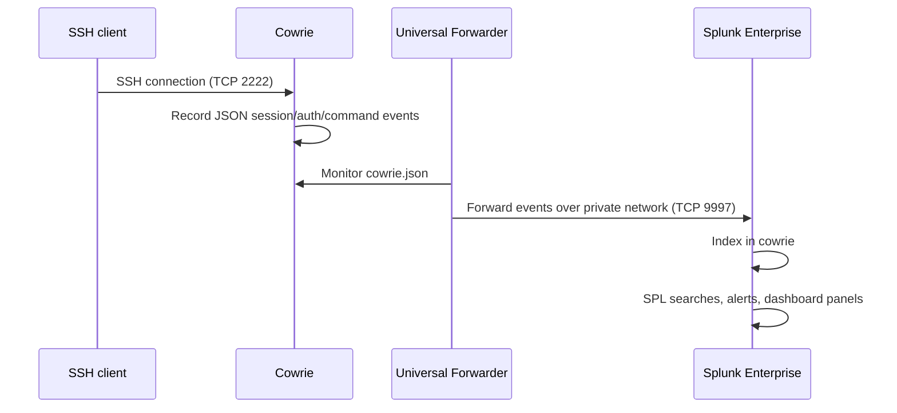

# Architecture and data flow reasoning

## Components

1. **Cowrie honeypot** runs on an Ubuntu cloud VPS and listens for SSH connections on TCP 2222.
2. Cowrie writes structured JSON events to its log file.
3. **Splunk Universal Forwarder** monitors the Cowrie JSON log and forwards events over the private Tailscale network.
4. **Splunk Enterprise** receives data on TCP 9997 and indexes it in `cowrie`.
5. Splunk searches, alerts, and dashboards analyze authentication and command events.

## Data flow

## Network exposure notes

- TCP 2222 is intentionally reachable for honeypot observation.
- TCP 9997 should remain restricted to the private overlay network or trusted source.
- Splunk Web should not be exposed publicly.
- SSH administration should be restricted to the operator's trusted address or private access path.
- Do not connect the honeypot to production networks or store real data on it.
