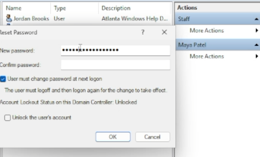

# HD-01 · Restore an advisor’s Windows sign-in

**GLPI #1** · Incident · High priority in the exercise · Reset recorded as complete

Maya reported that she had forgotten her Windows password. I reset her domain password, provided a temporary credential and instructed her to choose a new one the next time she signed in.

The Active Directory dialog shows the account as unlocked and **User must change password at next logon** selected. It captures the settings before I confirmed the reset. My notes record completion. A record of the requester identity check and a successful sign-in with the replacement password would complete the verification.

[Return to the ticket queue](../README.md)
