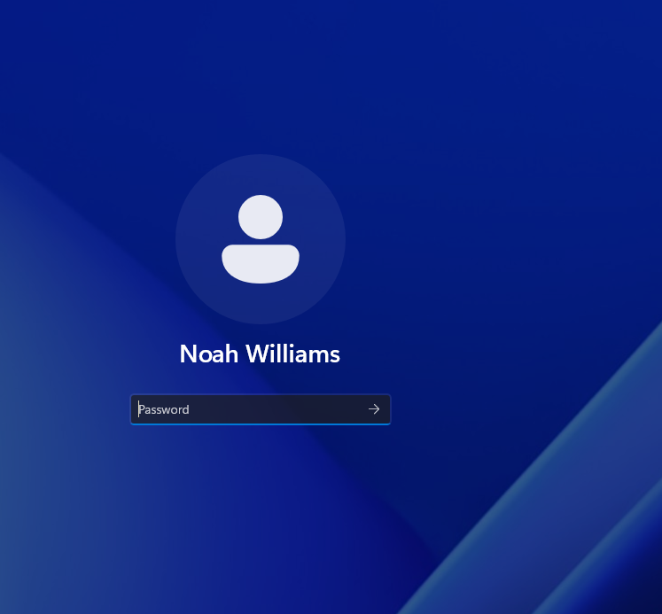
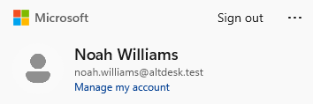

# HD-02 · Set up a new employee for the first shift

**GLPI #2** · Service request · Medium priority in the exercise · Account provisioned

I created Noah Williams’s account in Active Directory and updated the requester. The Windows sign-in screen displays Noah’s name. The second capture shows the signed-in identity `noah.williams@altdesk.test`.

One additional scope check would be to try the Dispatch share as Noah and record the expected denial for a new employee without Dispatch access.

[Return to the ticket queue](../README.md)
