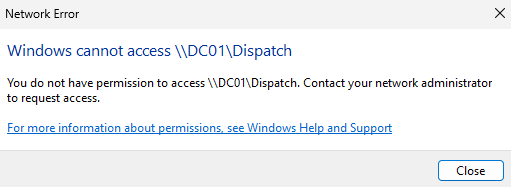
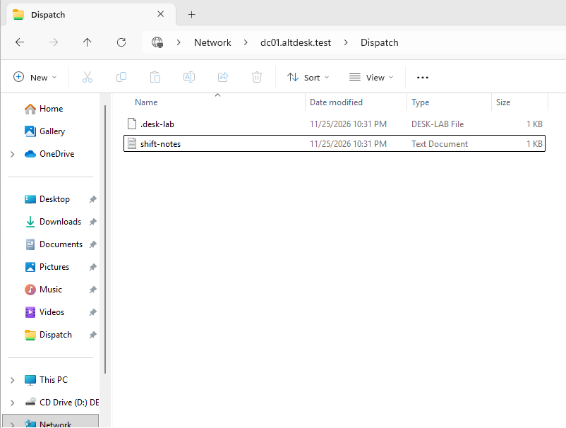

# HD-03 · Diagnose access to the Dispatch share

**GLPI #4** · Access request · High priority in the exercise · Folder access recorded as restored

Jordan could not open Dispatch. Olivia could reach the same resource, which gave me a working comparison. I checked Jordan’s Active Directory groups and found he lacked the group used for Dispatch. I approved access myself in this simulation and recorded that Jordan could then access the file server. For a workplace request I would record the data owner’s approval and the permitted level of access before the change.

## Access checks

Windows reported a permission denial when opening `\\DC01\Dispatch`.

The second capture shows the Dispatch directory and its shift notes under `dc01.altdesk.test`. The active Windows identities are outside both captures.

The requested permission was read-only. To establish the exact access level, I would record the active identity, Jordan reading the file, a denied attempt to create a file as Jordan, and a denied read from an account outside the group.

[Return to the ticket queue](../README.md)
