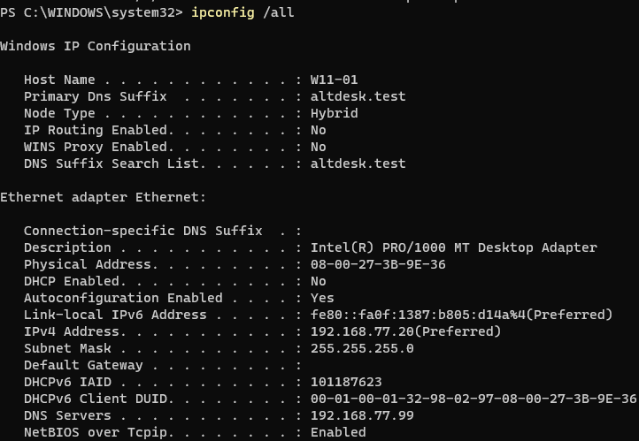

# HD-04 · Recover a workstation that lost the file server

**GLPI #3** · Incident · High priority in the exercise · Access recorded as restored

A user reported that W11-01 could no longer reach the file server. I ran `ipconfig /all` to compare the workstation’s network settings with the lab baseline.

| Setting | Captured on W11-01 | Expected in the lab |
|---|---|---|
| Workstation IPv4 | `192.168.77.20` | `192.168.77.20` |
| Primary DNS suffix | `altdesk.test` | `altdesk.test` |
| DNS server | `192.168.77.99` | `192.168.77.10` (DC01) |

I changed the client’s DNS server to `192.168.77.10`. My ticket records that the user could access the file server again. The capture above documents the fault. An after-change DNS lookup and a successful open of `\\dc01.altdesk.test\Dispatch\shift-notes.txt` would provide independent evidence of the repair.

[Return to the ticket queue](../README.md)
